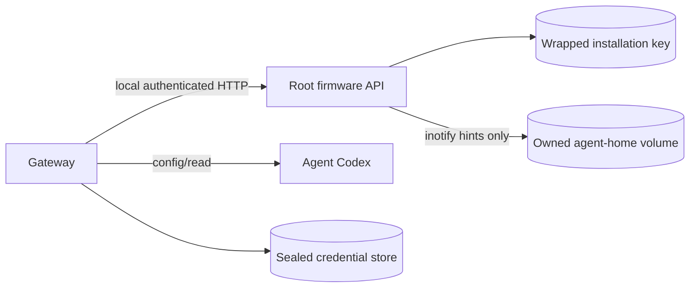

# SELF-7: Local device services API proposal

The Unix-socket design below is historical. [SELF-19](../SELF-19/ISSUE.md) implements the accepted
[Device API v3 stream](../SELF-14/DESIGN.md#device-api-v3). Runtime authorization comes from the
firmware opening a non-root exec into its verified owned container through the Docker API. The host
has no Device API socket or bearer-capability files.

## Status, Authority And Assumptions

Draft.2 for owner and the workloads repository review, 2026-11-03. The initial draft was
research/design only; the owner subsequently authorized firmware implementation
against this reviewed draft. Implementation and exact runtime evidence are
recorded separately in [PLAN.md](PLAN.md) and
[Local device services](../../../docs/device-api.md). ADR-0001 remains Proposed;
implementation does not turn every proposal below into accepted architecture.
[SELF-8](../SELF-8/ISSUE.md) remains the separate security assessment.

Assumptions: first target remains Ubuntu 24.04 amd64, systemd 255 and rootful
Docker; firmware remains one CGO_ENABLED=0 Go binary. Gateway owns OAuth, credential
records, refresh/revocation and Codex protocol use. Firmware supplies only local
opaque cryptography and optional invalidation hints. The consumer-review proposal
keeps the existing 10-second config/read reconciliation path as the correctness
mechanism; watch is an accelerator, not a prerequisite. Codex receives neither
API access nor Gateway credentials. Standalone Client support has a documented
default-disabled mode for an unchanged deployment.

The draft wire description is [device-api-v1.openapi.json](device-api-v1.openapi.json).
The rationale for the new privileged boundary is a
[Proposed ADR](../../../docs/decisions/0001-local-device-services.md).

## Proposal-Time Baseline And Architectural Delta

- Firmware has no Gateway listener. Its root-only CLI and systemd service apply
  the supplied fixed three-container stack. Its socket/address/API changes must
  not expose Docker, commands, arbitrary files or backend policy to Gateway.
- the workloads repository at <revision omitted> currently polls the
  agent App Server config/read every 10 seconds in internal/mcpadopt/adopt.go.
  Consumer review now recommends retaining it. The earlier removal proposal
  is superseded in this draft; no runtime change is claimed.
- mcpoauth/store.go stores per-server OAuth/client secrets together with cached
  tools; its current maximum document includes up to 32 * 512 KiB of tool data.
  Seal credential records separately; do not submit this entire cache to crypto.
- RFC 7592 management token and the DCR private key currently share
  device-identity.json. Merely introducing a new common store does not remove
  that existing plaintext copy. Identity/ingress private keys remain a separate
  coverage question; token encryption alone does not prevent identity cloning.
- Firmware's installation/volume namespace hashes workload_contract + profile ID
  + issuer. Changing device:v1 to device:v2 directly changes all volume names.
  Preserve the existing installation namespace explicitly before enabling v2;
  never interpret an empty new namespace as permission to register a new device.

## Research Findings And Recommendation

| Primary pattern | Applicable lesson | Boundary |
| --- | --- | --- |
| Azure IoT Edge workload API | Local HTTP endpoints expose encrypt/decrypt scoped to module/generation | Its API alone does not prove HSM/TPM properties for our Go process |
| AWS Greengrass IPC | Mounting the socket and authenticating the component are separate from authorizing operations/resources | Reuse the separation, not the AWS SDK/protocol |
| Balena Supervisor | Local supervisor APIs are versioned and authenticated | Its documented transport is TCP with an API key; do not describe it as our proposed UDS design |
| Android Keystore | Key extraction resistance differs from preventing permitted key use after app compromise | Our systemd-unwrapped key is present in firmware RAM, unlike a hardware-only private operation |
| systemd 255 credentials | Host and TPM combinations can wrap a small service key | A copied host secret/full VM can defeat host-only binding; recovery policy matters |
| inotify | Atomic replacement, lost watches and overflow need invalidation/reconciliation | It is a hint source, not an exact persistent configuration event log |

Recommend HTTP/1.1 JSON over one pathname Unix socket per installation, with a
bounded long-poll for invalidation. Both repositories already use Go net/http.
Varlink supports multi-reply calls but adds a different protocol/interface layer.
gRPC offers typed streaming but adds protobuf/HTTP2 machinery for four operations;
its deadlines still require explicit configuration. SSE is viable, but a single
25-second long-poll avoids a stream parser, heartbeat and replay machinery here.
Long-poll waits on inotify; firmware does not periodically read config.toml.
Gateway separately retains its protocol-based config/read polling. This revises
the first draft's event-only proposal, following the consumer's review.
These are project tradeoffs, not universal superiority claims.

## Protection Goals And Non-Goals

Protect an isolated copy of the Gateway credential store from offline reading
without the installation key. Prevent Codex and unrelated local/container callers
from invoking crypto or learning config contents. Preserve installation identity,
credential readability and data through approved replacement/restart paths.

A live compromised Gateway may call unseal for its own records and exfiltrate
plaintext. Host root can access firmware memory, the Docker socket and mounted
credentials. systemd-creds does not turn the Go AEAD key into a non-exportable TPM
key. Host-only protection does not resist a full disk/VM clone containing the
host secret; VM snapshots containing vTPM state are not assumed unclonable.
There is no ciphertext freshness/anti-rollback guarantee in v1. No claim that
an entire copied identity volume is useless follows from encrypting tokens.
SELF-8 separately assesses these attack paths and residual risks.

## Transport, Caller Binding And Installation Wiring

Protocol URI: urn:amnezia-gpt:device-api:v1. Requests use the /v1 prefix. Proposed
container paths and env names below are contract choices, not existing inputs.

The boundary is deliberately asymmetric:



- Host parent /run/agent-firmware is root:root 0700. A per-installation child
  contains api (root:65532 0750) and api/socket (root:65532 0660) on the initial
  supported non-remapped rootful host. Rootless/userns-remapped mappings need
  explicit additional proof; do not infer peer UID from the container username.
  Bind only the api directory read-only at /run/firmware-device-api in Gateway.
  Mount the directory, not the socket inode, so daemon restart can replace it.
- A separate auth directory, below a root-only host parent, contains a random
  256-bit bearer capability. Its mounted leaf directory is Gateway-owned 0500,
  the token file 0400. Mount it read-only at /run/firmware-device-api-auth. Never mount
  the parent containing wrapped keys, general firmware state or other principals.
- Propose FIRMWARE_DEVICE_API_MODE=required|disabled, FIRMWARE_DEVICE_API_SOCKET and
  FIRMWARE_DEVICE_API_TOKEN_FILE. An unset or empty MODE means disabled for unchanged
  Amnezia Client deployments. Any other value is invalid configuration, never an
  alias for disabled. Firmware's device:v2 adapter always sets required explicitly
  and verifies the actual container environment as part of drift detection.
  Only paths/mode go in env; the capability does not. In required mode a missing
  socket, auth failure or incompatible API makes credential-dependent operations
  unavailable, never plaintext. Socket absence alone is not mode detection.
  A sealed store is not opened/overwritten as plaintext even in disabled mode;
  explicit data migration is required for any change in protection mode.
- Server checks SO_PEERCRED for the expected host-mapped Gateway UID, then the
  capability, then operation scope. Current Gateway UID is 65532, shared across
  images/installations; UID alone is not a container identity. Root callers do
  not automatically acquire the Gateway protocol principal. Root administration
  stays on its separate CLI/filesystem path.
- A capability authorizes only one installation's Gateway crypto and its agent
  user-config watch. Neither installation, issuer nor role comes from request
  fields. The listener/auth registry supplies that context. No wildcard resources.
- Keep capability stable through ordinary daemon/container restart. Root may
  rotate it explicitly; clients reopen the mounted token file once after 401.
  Old/foreign capabilities fail. Replacement/rollback and concurrent old instances
  need tests; this token is not strong attestation of a particular container PID.
- No TCP listener, public reverse proxy, CORS or generic API forwarding. Clients
  dial the configured Unix path directly, ignore proxy env, follow no redirects,
  use fixed Host firmware.local, and never accept caller-supplied endpoint URLs.
  A read-only socket mount does not make the API operations read-only.
- Requests have exact case-sensitive fields, reject duplicates/unknown fields,
  invalid Unicode, trailing JSON, unsupported content types and compression.
  Reject unknown/duplicate query parameters. Error bodies contain only fixed codes.
  Application replies use Cache-Control: no-store. The HTTP parser may reject
  malformed requests or excessive headers before JSON handling (400/431); clients
  classify the status without interpreting an arbitrary non-JSON body.
  Request/body/header logging is forbidden.

## Operations And Wire Semantics

All endpoints require Authorization: Bearer <mounted capability>. Any HTTP
example uses a synthetic value; no token is recorded in fixtures or documentation.

| Method/path | Purpose | Success |
| --- | --- | --- |
| GET /v1/capabilities | Verify API/profile, service state and actual protection | 200 Capabilities |
| POST /v1/crypto/seal | Encrypt one opaque credential record | 200 SealedRecord |
| POST /v1/crypto/unseal | Decrypt one record for the same principal/context | 200 PlainRecord |
| GET /v1/config/agent/changes | Initial snapshot or wait for an invalidation | 200 ConfigChange |

Discovery advertises a bounded open list of URN capabilities. Initial services:
urn:amnezia-gpt:device-service:credential-seal:v1 and optional
urn:amnezia-gpt:device-service:codex-config-watch:v1. Unknown well-formed URNs are
ignored; required-mode Gateway requires credential-seal, not the watch service.
Keep exact JSON fields and typed values, but do not close the service-identifier
namespace with an enum. At most 32 unique URNs, each at most 256 characters.
An unsupported API major or missing required capability is a compatibility
failure: Gateway stays alive with its credential store unavailable. config_watch
metadata is present iff that service is advertised; without the service, watch
returns 404. An advertised but temporarily unavailable watch returns 503 and
never disables sealing or periodic config/read. Release metadata schema v2,
workload contract device:v2, local API v1 and ciphertext format v1 are independent
versions.

Seal request (plaintext is canonical unpadded base64url; the example decodes to
an empty JSON object, not credentials):

```json
{"purpose":"gateway-session","record_id":"default","plaintext":"e30"}
```

Response is {"sealed":"<opaque afseal1 envelope>"}. Unseal takes purpose,
record_id and sealed, and returns {"plaintext":"<base64url bytes>"}. Initial
purposes are gateway-session, registration-management and mcp-oauth. Discovery
credential_protection.purposes lists this principal's supported/authorized
purposes (up to 32 unique values). Purpose syntax is [a-z][a-z0-9-]{0,63}, not a
closed protocol enum. Unknown advertised identifiers are ignored unless needed;
new purposes can be introduced within API v1 without changing wire framing or
old purposes' meaning. Syntax or a request never creates a new authorized purpose.
A request for a purpose absent from that principal's advertised allowlist returns
400 unsupported_purpose, not an implicitly created key/namespace. Gateway checks
that every purpose its current store needs is available before credential work.
record_id is an opaque 1..128 byte ASCII identifier; the reported MCP server ID
is 16 base64url characters and fits this pattern.
Firmware never parses tokens, issuer URLs, tools or OAuth payloads. No caller
can ask for raw key material, choose an algorithm/nonce/key, run a command, open
a file, register a filesystem path, or change backend/TPM/key policy through API.

### Sealed Envelope And Context

Proposed first algorithm: AES-256-GCM using Go 1.27.3 NewGCMWithRandomNonce.
Opaque representation: afseal1. followed by canonical base64url of raw key ID
(16 bytes) followed by the AEAD output (nonce 12 bytes, ciphertext, tag 16 bytes).
The prefix fixes the envelope/algorithm profile; clients store/return it unchanged.
The service chooses a random key ID, represented in discovery as k1_ plus its
22-character base64url encoding. Unseal chooses only a key belonging to the
already authorized installation, never a caller-selected global key namespace.

AAD is encoding/json's compact encoding of this fixed array of strings:
["afseal1", installation_id, "gateway", key_id, purpose, record_id]. Allowed
identifiers use ASCII. API auth token, container ID, release digest and watch
cursor are excluded so ordinary upgrades do not invalidate stored ciphertext.
A wrong installation/purpose/record, unknown key, malformed envelope or bad tag
returns ciphertext_rejected with no plaintext or more detailed oracle response.
This is conventional AEAD framing, not a new cryptographic primitive; format
vectors and independent security review are required before first implementation.

Firmware durably reserves encryption budget before using random nonces and
never exceeds 2^32 encryptions for one key, across restarts. Interrupted reserves
may be consumed unused. Exhaustion returns key_rotation_required for seal while
unseal stays available. No silent new key or public key-rotation operation.
Administration must re-encrypt through an explicit reviewed rotation workflow;
its implementation is not hidden inside the API task. Full state rollback/clone
and old-but-valid ciphertext replay remain outside the freshness guarantee.

Seal has no credential-store side effect. A lost reply may be retried once within
the original budget: the new ciphertext may differ, and only Gateway's selected
reply is atomically committed. Unseal is read-only and replay-safe within budget.
Neither operation performs cloud calls. Gateway owns durable record writes,
fsync/rename, serialization and refresh-token race control. Discovery/store state
is not a caller deadline extension; a hint-triggered config/read/adoption pass is
a separate workload-owned bounded operation, not work hidden inside long-poll.

## Key Provisioning, Loss And Credential Coverage

Generate one 32-byte installation key only in an explicit root bootstrap or
migration step; wrap with systemd-creds and retain only its wrapped form and
non-secret key ID/protection metadata under root-only firmware state. Load it
through LoadCredentialEncrypted at service activation; firmware uses it in RAM.
No key material in argv/env/logs, no per-request TPM or subprocess operation.
Disable routine coredumps; do not promise complete Go-memory zeroization or
protection from host root. Failed unlock prevents crypto readiness, but it must
not make Gateway's process healthcheck fail or trigger registration/reset.

Revised first-delivery recommendation: host-only wrapping, fixed at provisioning;
no TPM detection, auto-selection or TPM implementation in this slice. Report host
truthfully and never use a zero-key mode. The existing host+tpm2 wire identifier
is reserved for separately reviewed future work, not advertised by this delivery.
A future protection change requires explicit migration and proof; a reboot or
failed unlock never changes protection mode. TPM PCR/update and VM snapshot
expectations remain part of the future security assessment.

A copied Gateway data volume lacks the firmware key. A complete copy including
host wrapping secret may not. A reinstall must retain firmware key state together
with the existing workload identity. Missing/corrupt key state with existing
workload data is action_required: do not create a replacement key, overwrite
ciphertext, reset identity or fall back to plaintext. Explicit new-install versus
migration admission is needed; an empty firmware directory alone is insufficient.

Credential coverage for the first store:

| Material | Owner / proposed storage |
| --- | --- |
| Gateway compute/OAuth refresh/access and Router credentials | Gateway common store; sealed records |
| RFC 7592 URI/token | Gateway common store; migrate existing identity-file token without changing device identity |
| MCP OAuth client secret/access/refresh tokens | Gateway common store, one sealed record per server |
| MCP cached tools and ordinary metadata | Gateway non-secret cache; not part of 64 KiB crypto record |
| DCR signing key and ingress recipient private key | Existing identity volume; moving/protecting these is an explicit additional decision |
| Firmware wrapping key / local capability | Firmware private host state; never passed as cloud credentials |

Loss can require new compute/MCP sign-in. It can also lose the one-time RFC 7592
management token. Existing workload a decision record may require explicit new registration
and ingress identity; it is not safe to promise that a normal login restores all
management credentials. Preserve original ciphertext/history and require an owner
recovery decision. No automatic identity replacement is approved here.

Migration is a Gateway-owned durable transaction: read old records; seal all;
write/sync a new version; verify it can be reopened; atomically commit; only then
retire old plaintext copies. Startup understands interrupted states and never
mixes plaintext/sealed writes. Quarantine preserves corrupt bytes and is itself
sensitive; a plaintext quarantine/old backup prevents a ciphertext-only-at-rest
claim. Prevent rollback to readers that would overwrite the new store or recreate
plaintext. The exact common-store format/migration belongs in the workloads repository.

### Quarantine Availability Constraint

Ciphertext-only quarantine is the desired required-mode storage result, not an
operation possible without a working key/API. If a corrupt legacy store may
contain plaintext and crypto is unavailable, leave the original in place with
restricted permissions, refuse credential work and report unavailable. Do not
duplicate it into a new plaintext quarantine, erase it or initialize an empty
store. Once crypto is usable, encrypt/verify the preserved bytes transactionally
before retiring the original. Already sealed data can stay opaque.

An old MCP document may exceed the per-record 64 KiB limit. the workloads repository must
define bounded chunking or its own transactional quarantine format; do not expand
the firmware API to read arbitrary files or silently remove its record bound.
Disabled standalone mode deliberately uses plaintext and must report encryption=off;
its preservation/quarantine policy cannot claim ciphertext-only protection.

## Configuration Change Hints

Resource urn:amnezia-gpt:device-resource:codex-agent-user-config:v1 maps, in the
workload contract, to role=agent, volume=agent-home, relative path=config.toml.
Current container path is /home/codex/.codex/config.toml. The relative mapping is
a reviewed adapter table for that workload URI; never a path provided by Gateway
or an arbitrary path from unsigned free-form metadata.

Firmware resolves only its verified local Docker volume, pins the directory,
watches the parent and filters that basename. Do not read/parse config.toml or
follow its symlink target. Cover create, modify (including a writer that keeps
its descriptor open), close-write, attribute changes, rename/replacement, removal,
watch invalidation and volume rebinding. File absence is normal. Missing volume,
unsupported driver/mount or containment uncertainty is watch_unavailable, not
permission to watch another directory. Remote filesystems are not covered.

Wire requests use after (opaque cursor, at most 80 ASCII characters) and
wait_seconds (1..25, default 25). Without after, install the watch first and
return current cursor with resync=true. A changed/foreign/old epoch cursor returns
immediately with resync=true. An unchanged cursor waits, then returns the same
cursor with resync=false on timeout. Replies never carry paths, file names,
contents or file hashes. After restart, overflow or rebind, change epoch/cursor
and require a full authoritative resync; there is no durable event replay log.

Gateway installs the subscription before the initial config/read, performs one
startup reconciliation, and retains a dirty signal if another hint arrives
while reconciliation runs. It advances the processed cursor only after a
successful config/read/adoption pass; on failed pass retain dirty state and use
bounded retry/backoff. Coalesce bursts; self-generated config writes must converge
and not create reload storms. An overflow is invalidation, never 'no change'.
Reconnect similarly re-synchronizes. Preserve periodic config/read reconciliation
with the existing 10-second scheduling in both modes, plus startup and on-demand
login/status checks. Schedule poll, startup/on-demand and hint work through one
serialized reconciliation worker; merge dirty hints rather than running duplicate
passes. An in-flight pass may add its duration to the existing scheduling delay.
Polling continues when watch is absent, failing or healthy. Watch success is not
proof of complete config coverage and never disables the polling path.

This optional watch observes the user-level config file only. Project/included/managed layers
and per-session overrides may change effective configuration without this event.
Do not claim complete effective-config observation unless the workload contract
also covers those sources or Codex provides a native change notification.
Periodic reads recover changes visible in the particular config/read context;
they are not proof that every per-session/project override is globally observed.

## Resource, Deadline And Failure Contract

These are proposed engineering defaults for one Gateway, not measured SLOs.

| Boundary | Proposed bound / owner |
| --- | --- |
| Unary caller total | Gateway 3 s, at most 2 attempts in that same budget |
| Unix connect | Gateway 250 ms; no DNS/TLS/proxy/redirect |
| Header read | Firmware 500 ms ReadHeaderTimeout; no application-body logging |
| Unary server | Firmware handler 2 s after headers, including body/crypto/write; immediate admission |
| Request headers/body | 8 KiB headers; 128 KiB JSON cap; decoded plaintext 1..65536 bytes |
| Unary response | 128 KiB; body always closed; transport reusable, max 2 conns |
| Long-poll | Server 25 s hold; client 30 s total, headers 28 s, connect 250 ms |
| Pools | Separate watch connection (max 1) so it cannot starve unary calls |
| Admission | Per installation 2 unary + 1 watch; global 16 accepted connections; no unbounded queue |
| Rate | Crypto 20 requests/s burst 40 per principal; 429 with Retry-After: 1 |
| Watch bursts | At most one pending dirty cursor; 100 ms coalescing with max 500 ms delivery delay |
| Shutdown | Cancel calls/watches; close listener/FDs/transports, allow 5 s drain within existing service stop budget |

Retry only transport/503/429 when safe and affordable. Never retry malformed
input, incompatible protocol, forbidden context or rejected ciphertext as a new
login/reset. A 401 allows one token-file reopen in the same operation budget;
persistent failure is authorization_required. Background watch reconnect is
owned by Gateway until context cancellation, with full-jitter exponential delay
250 ms..30 s. Each attempt retains its own 30 s ceiling; no accumulated open
streams, goroutines, response bodies or parallel reconnect loops. Configure
route-specific deadlines: a unary write deadline must not terminate a 25-second
watch. Watch cancel immediately releases its slot. Firmware must keep crypto/watch work off the
long-held Docker application lock; use bounded short key-state locks. A deadline
bounds caller waiting/cancellation, not physical disk completion. Counter-budget
persistence may finish after a timed-out call; keep at most one owned reservation
worker and do not return successful seal before its reservation is durable. A
stalled OS operation must not spawn an unbounded replacement-worker/retry chain.

Error envelope: {"error":{"code":"ciphertext_rejected","retryable":false}}.
Codes/statuses: invalid_request or unsupported_purpose 400; unauthorized 401;
forbidden 403; not_found
404; method_not_allowed 405; key_rotation_required 409; payload_too_large 413;
unsupported_media_type 415; ciphertext_rejected 422; resource_exhausted 429;
internal_error 500; keystore_unavailable or watch_unavailable 503. 429/503 may
include bounded Retry-After. Do not include raw I/O/TPM errors or request fields.
Unknown API major returns not_found; client classifies unsupported_api, not a
plaintext-mode invitation.

## Deployment, Versioning And Preserved Identity

Recommend workload URI urn:amnezia-gpt:workload-contract:device:v2 for a layout
that requires credential-seal from this API. Config watch is optional and not
part of the mandatory availability gate. The local API itself is v1; release metadata stays schema
v2, profile v3 and trust bundle v1. Do not silently add a mandatory API to the
already published device:v1 layout. A Gateway binary may implement explicit
required and disabled modes, with missing/empty env defaulting to disabled for
unchanged Client installations. This default is never permission to rewrite an
already sealed store as plaintext. Legacy Client compatibility still needs a
real test; firmware device:v2 must set required and cannot infer mode from socket
presence or availability.

Before v2 can be enabled, separate persistent installation identity/namespaces
from workload compatibility version. Existing verified v1 volume names must be
retained, never recreated under a new hash. Require an explicit, tested migration
mapping for owned legacy firmware resources; this is not Amnezia Client adoption.
Do not retire the v1 publication path until the Client rollout/pinning decision
is made. Publisher emission of a new URI follows consumer readiness, not vice versa.

New startup order: prepare key/socket/auth mount sources -> start firmware API
-> start Gateway's management/status process independently of crypto availability
-> start Codex roles -> optionally bind verified volume watch. Gateway Docker
health remains process/management liveness. This matches the existing image's
healthcheck on /healthz; it must not be changed to a credential readiness check.

In required mode, Gateway starts healthy even if the socket is absent, auth fails,
capabilities/purposes are incompatible, the key cannot be unlocked, or the store
cannot be opened. It reports credential_store=unavailable through its own status
contract with a bounded reason/action. New credential-dependent work is refused;
no OAuth/refresh/store mutation is initiated without a usable durable store, no
unbounded work queue is retained, and no logout/new registration is synthesized.
After transient API recovery the same store is reopened/reconciled and status can
return ready without recreating the device. Corruption/key loss instead requires
the explicit owner recovery workflow owned by the workloads repository.

Firmware/systemd readiness, Gateway process health, credential availability and
cloud availability are distinct signals. Optional watch readiness never blocks
Gateway or firmware convergence. Firmware may still fail its own key/service
activation if credentials cannot be loaded; that must not make a running Gateway
exit or erase state. No health result alone proves credential/cloud readiness.

Initial watch may return 503 until the agent volume is ready, then force resync;
periodic config/read remains independent. A new socket inode is seen through the
directory bind mount. Boot/restart, Docker restart policies and API recovery need
actual host tests; neither schemas nor passing unit tests establish that proof.

## Observability And Security Review Boundary

Observability impact: new local auth, crypto, key readiness and watch-loss states.
Firmware owns bounded events device_api_auth, device_api_request and config_watch
with operation/phase/outcome enums; Gateway owns credential_store_mode and local
client/reconciliation outcomes. Allow aggregate duration seconds, in-flight and
rejection counters locally, with no new public exporter. Counters are independent
from logs; dropped/throttled diagnostics must not fail or stall crypto.

Log transitions for key ready/unavailable, watch ready/unavailable/resync, required
API unavailable, credential_store ready/unavailable and standalone encryption=off
(including the documented legacy default). Missing optional watch is not a
credential-store failure. Health remains independent from all these transitions. Aggregate/rate-limit auth
failures. Never log tokens, plaintext/ciphertext, record IDs, key IDs, cursors,
file contents/paths, issuer URLs, arbitrary errors or raw headers. Root diagnostics
may report the fixed protection enum and required operator action. Firmware local
readiness is distinct from cloud login/check-in/WebUI readiness. SELF-8 owns the
wider attack assessment; this proposal is not a completed security audit.

## Delivery Roadmap And Required Proof

No dependent implementation plan is accepted yet. Proposed sequence:

1. Settle this contract/threat boundary; pin shared wire fixtures with the
   workload team. Keep SELF-8 as a separate assessment with targeted gates.
2. Preserve stable installation namespaces and define non-destructive v1->v2
   transition before any publisher/validator starts selecting device:v2.
3. Implement bounded API/auth/key bootstrap and Gateway adapter with tests.
4. Implement common-store migration/rollback floor in the workloads repository, keeping
   process health independent of credential availability. Add the optional
   parent-directory watch accelerator; retain polling/startup/on-demand checks.
5. Prove the complete slice on a selected disposable host before publishing v2.

Required evidence: request/response fixtures and error mapping; wrong UID/token/
installation denial including same-UID wrong container; no socket/key/CODEX_HOME
mount in Codex/Gateway respectively; crypto context/tamper/restart/budget tests;
no auto-key reset or plaintext downgrade; atomic migration/quarantine/interrupted
refresh and rollback tests; rename/deletion/recreate/overflow/reconnect/watch flood
and symlink tests; project-layer limitation; all phases' cancellation/saturation
bounds; real unit boot/restart and socket replacement; Gateway credential refresh,
MCP adoption with polling intact (watch present/absent/failing), serialized
poll+hint work, default-disabled legacy startup and mandatory firmware env, unknown
capability/purpose compatibility, healthy-but-unavailable Gateway recovery and
prior identity/history/WebUI behavior. First delivery proves host-only protection;
TPM remains outside the implementation/proof scope. No live tests are authorized
merely by this design document.

## Owner Decisions Still Open

1. Accept HTTP/JSON + long-poll, and socket permissions + peer UID + a scoped
   mounted capability instead of socket presence alone?
2. Accept required-mode device:v2 with identity/namespace preservation first,
   missing/empty mode env = disabled for Client, mandatory required env from
   firmware, and no silent plaintext downgrade or sealed-store rewrite?
3. Accept first-delivery host-only protection (TPM deferred), fixed mode,
   action-required key-loss recovery and identity keys remaining in their existing
   volume? No whole-volume unreadability/unclonability claim follows.
4. Accept optional user-level config hints while preserving the existing periodic
   protocol reconciliation, and healthy process startup with credential_store
   unavailable when required crypto cannot be used?

## Sources And Exact Local Evidence

Primary sources inspected, with short application notes:

- [Azure workload API Swagger](https://github.com/Azure/iotedge/blob/main/edgelet/api/workloadVersion_2020_07_07.yaml),
  API version 2020-07-07, inspected blob <revision omitted>:
  HTTP crypto endpoints are module/generation scoped. Its IV choice is not copied.
- [AWS Greengrass IPC](https://docs.aws.amazon.com/greengrass/v2/developerguide/interprocess-communication.html)
  and [container IPC](https://docs.aws.amazon.com/greengrass/v2/developerguide/run-docker-container.html):
  separate component authentication, operation/resource authorization and connection reuse.
- [AWS secret manager IPC](https://docs.aws.amazon.com/greengrass/v2/developerguide/ipc-secret-manager.html):
  scoped secret retrieval, not a reason to expose all host secrets.
- [Balena Supervisor API](https://docs.balena.io/reference/supervisor/supervisor-api):
  versioned authenticated HTTP; broad supervisor operations deliberately excluded here.
- [Android Keystore](https://developer.android.com/privacy-and-security/keystore):
  a compromised client may use its keys; hardware-backed extraction resistance is distinct.
- [systemd-creds 255](https://www.freedesktop.org/software/systemd/man/255/systemd-creds.html)
  and [systemd.exec 255](https://www.freedesktop.org/software/systemd/man/255/systemd.exec.html):
  explicit wrapping profiles, service credential loading and privileged access limits.
- [Linux unix(7)](https://man7.org/linux/man-pages/man7/unix.7.html):
  pathname permissions, SO_PEERCRED and abstract-socket limitations.
- [Linux inotify(7)](https://man7.org/linux/man-pages/man7/inotify.7.html):
  queue overflow, inode replacement and unmount/rebind caveats.
- [Varlink calls](https://varlink.org/Method-Call.html),
  [gRPC deadlines](https://grpc.io/docs/guides/deadlines/),
  [SSE](https://html.spec.whatwg.org/multipage/server-sent-events.html):
  alternatives considered; choosing a transport does not supply lifecycle bounds.
- [Go crypto/cipher 1.27.3](https://pkg.go.dev/crypto/cipher@go1.27.3#NewGCMWithRandomNonce)
  and [net/http 1.27.3](https://pkg.go.dev/net/http@go1.27.3):
  standard-library AEAD/nonce budget and explicit server/client timeout APIs.

Firmware base is <revision omitted> with uncommitted Go code;
workload HEAD above is a source baseline, not a live artifact claim.

| Inspected source (relative to named repository) | SHA-256 |
| --- | --- |
| firmware internal/workload/model.go | <digest omitted> |
| firmware internal/workloadrelease/release.go | <digest omitted> |
| firmware scripts/install.sh | <digest omitted> |

## Initial Draft Validation (2026-11-03, before consumer review)

- openapi-spec-validator 0.9.0 accepted the OpenAPI 3.1 document. jsonschema
  4.26.0 checked component schemas, seven positive examples and five deliberately
  invalid examples (unknown field/purpose, path-like record ID, malformed sealed
  envelope and excessive cursor). Tools ran in a temporary uv environment; no
  product dependency or repository validation gate was added.
- These checks prove schema/example consistency only, not server behavior,
  crypto correctness, caller authorization, inotify completeness or host support.
  Synthetic sealed examples are shape-valid and explicitly not crypto vectors.
- Current code paths and cross-repository a decision record were read. Proposed endpoint
  fields, modes, key framing and defaults remain unimplemented and unaccepted.
- Scope review retained the bootstrap/credential ownership split. Namespace
  stability, key-loss registration recovery and effective-config coverage are
  explicit design constraints. The security assessment is separately tracked.

## Consumer Review Revision (2026-11-03)

The owner supplied the workload team's review. This draft incorporates its five
API corrections and narrows the first proposed delivery to host-only wrapping.
The review agrees with transport/auth, record size/AAD, cache separation and
fail-closed key loss. It is not independent owner approval or runtime evidence.

1. Bounded, extensible capability URNs; require the used subset, ignore unknowns.
2. Extensible purpose identifiers plus an advertised per-principal allowlist;
   no arbitrary-purpose authorization or automatic key creation.
3. Unset/empty mode defaults disabled for unchanged Client; firmware always sets
   required. Existing sealed stores never silently become plaintext.
4. Watch is optional acceleration; keep the existing periodic config/read path.
   This supersedes the first handoff/draft's polling-removal proposal.
5. Gateway stays healthy with status/management available while required crypto
   or storage is unavailable; refuse dependent work, preserve state and recover
   without crash loops or implicit re-registration.

Workload ownership: common credential store, transaction/rollback floor,
quarantine format, API client, modes, explicit owner recovery and health/status.
Firmware ownership: local scoped API, host-only installation key/protection,
namespace preservation, adapter env/mounts and optional known-resource watcher.
The resource mapping stays role agent / volume agent-home / config.toml in
proposed device:v2. No new publication/digest in a running CI job is assumed or
deployed during this design-only review. Security assessment remains SELF-8.

### Draft.2 Validation

openapi-spec-validator 0.9.0 and jsonschema 4.26.0 passed structural validation,
11 positive and 12 negative schema cases. Cases include an added unknown service,
credential-seal without watch, future advertised purposes and syntax-valid future
requests; duplicate/excessive/bad identifiers, watch metadata inconsistent with
its capability and malformed requests are rejected. Runtime allowlist checks,
legacy env defaults, process health and recovery remain unimplemented assertions
to prove in later tests, not results of schema validation. No product dependencies,
code or live resources changed during this review.
